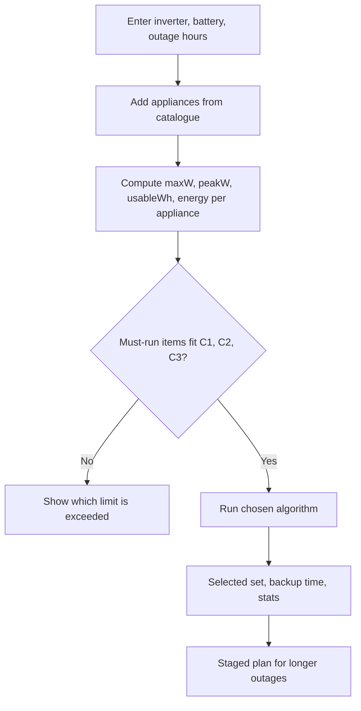
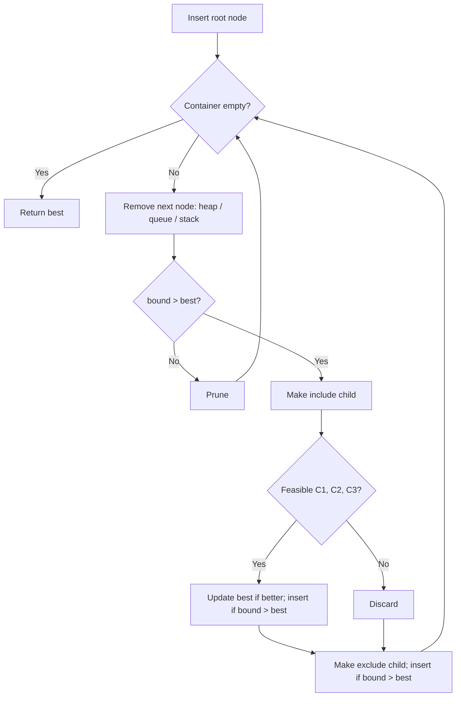
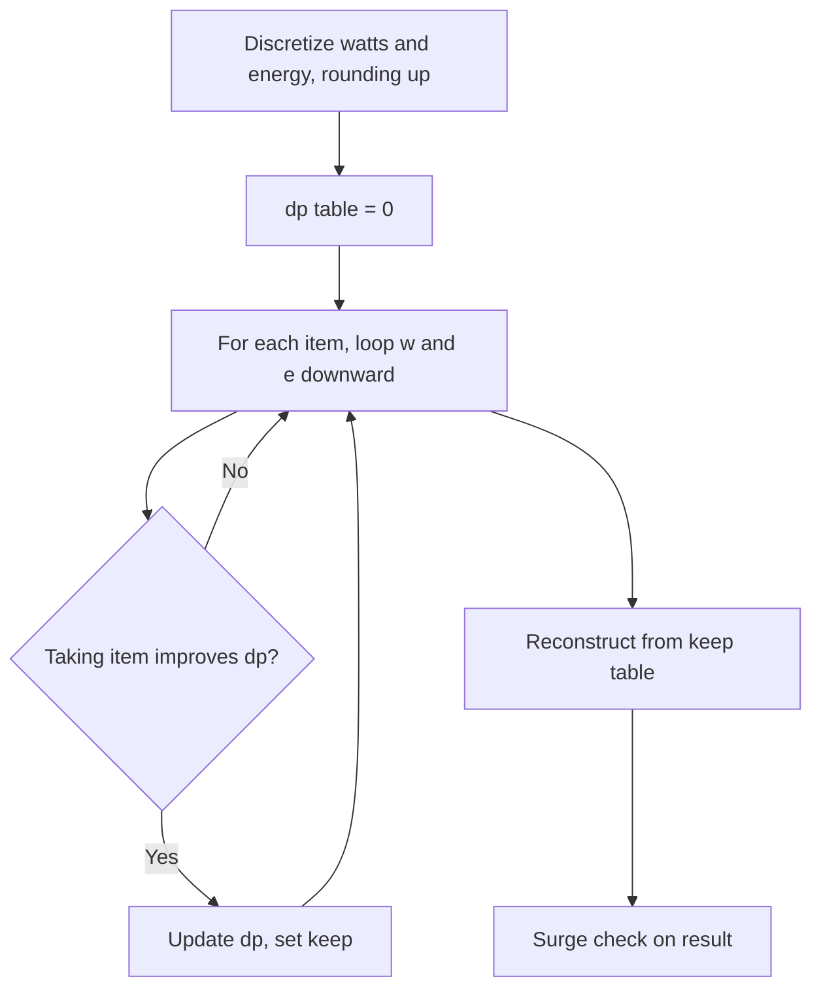

# Ujala — Power Cut Planner
### PRD for the DSA Mini Project (demo: 29–31 October 2026)

**One line:** When the power goes out, Ujala tells a household exactly which appliances to keep on so the inverter never trips and the battery lasts as long as it's needed, using greedy, dynamic programming and branch and bound.

("Ujala" means light. Rename freely.)

---

## 0. How to use this document

1. Make a folder `ujala/` and save this file in it as `PRD.md`.
2. **Build the backend first** with the prompt in Section 13.1. The algorithms are what gets graded.
3. Install the design skill, then build the frontend with the prompt in Section 13.2:
   ```bash
   npx skills add https://github.com/Leonxlnx/taste-skill --skill "design-taste-frontend"
   ```
   It needs **Node 22+** and **Chrome/Edge/Chromium** installed. One page build with it takes roughly 30–45 minutes.
4. Write the report using Section 15 (it maps every section the notice asks for to content already in this PRD).
5. Run through the demo checklist in Section 17 the day before.

**Priority labels:**
- **P0** = must work in the demo.
- **P1** = adds marks if time allows.
- **P2** = future scope only (mention in the report's conclusion).

**Time reality:** today is 27 October. If your lab slot is on the 29th, you have about a day and a half. Follow the build order in Section 16 and cut from the bottom, never the top.

---

## 1. Problem statement

During a power cut, households running on an inverter have to guess what to switch on. Two things go wrong:

1. **Overload:** too many appliances at once, or a motor (fridge compressor, water pump) starting up, exceeds the inverter's capacity and it trips.
2. **Early drain:** the battery runs out before power returns, because energy went to low-priority appliances while important ones (fridge, Wi-Fi router, a fan in the bedroom) needed it.

The household needs to choose the most valuable set of appliances that fits the inverter's load limit, the battery's usable energy, and the start-up surge limit.

## 2. Objectives

1. Model the household's inverter, battery and appliances from values printed on their labels.
2. Find the best set of appliances to run, maximizing total importance within all constraints.
3. Show why the choice of algorithm matters: compare greedy, dynamic programming, branch and bound (FIFO, LIFO, least-cost) and brute force on the same input, measuring correctness, operations and time.
4. Give a staged plan for long outages ("after hour 3, switch off fan 2").
5. Present it in a clear, problem-themed interface that anyone in the household could use.

## 3. Why this matters (applications)

- Homes in areas with regular outages that rely on inverters.
- Homes with elderly members or students, where specific devices must stay on.
- Small shops and clinics running lights, fans and card machines on backup.
- The same model applies to solar battery systems and UPS planning for small offices.

## 4. How the app connects to the inverter

It doesn't. Ujala is a **planner, not a controller**. Every input comes from labels: the inverter's VA rating, the battery's Ah and voltage, and each appliance's wattage (with typical defaults from a built-in catalogue). The user switches appliances by hand according to the plan. Connecting to smart inverters or smart plugs is **future scope (P2)**.

---

## 5. The model (exact formulas)

### 5.1 Inputs
| Input | Example | Notes |
|---|---|---|
| Inverter rating (VA) | 800 | From the inverter label |
| Power factor (PF) | 0.8 | Default; editable |
| Surge tolerance | 1.5 | How far above rated load the inverter tolerates for a moment; default 1.5, editable |
| Battery capacity (Ah) | 150 | From the battery label |
| Battery voltage (V) | 12 | 12 or 24 |
| Battery type | Tubular | Sets safe depth of discharge (DoD) |
| Battery health | 100% / 80% / 60% | New / 2–3 years / older |
| Inverter efficiency | 0.85 | Default |
| Expected outage (hours) | 4 | User's estimate |
| Appliances | list | Name, watts, quantity, importance 1–10, surge factor, duty cycle, hours needed, must-run flag |

**Depth of discharge defaults:** flat plate 0.5, tubular 0.7, lithium 0.9.

### 5.2 Derived capacities
```
maxW      = VA × PF                                  (running load limit, watts)
peakW     = maxW × surgeTolerance                    (momentary limit during a motor start)
usableWh  = Ah × V × DoD × health × efficiency       (energy available, watt-hours)
```
Example: 800 VA → 640 W running, 960 W peak. 150 Ah × 12 V × 0.7 × 1.0 × 0.85 ≈ **1,071 Wh usable** (not the 1,800 Wh the label suggests).

### 5.3 Each appliance (each unit counted separately; 3 fans = 3 items)
```
w_i  = rated watts
e_i  = w_i × min(hoursNeeded_i, T) × dutyCycle_i      (energy it will use, Wh)
x_i  = surge extra = (surgeFactor_i − 1) × w_i         (0 for non-motor loads)
v_i  = importance (1–10)
```
- **Duty cycle:** a fridge compressor runs about 40% of the time (0.4); a fan or light runs 100% (1.0).
- **Hours needed:** a water pump might need only 0.5 h of the outage; a fan needs all of it.

Because appliances use energy for different lengths of time, the **load constraint and the energy constraint have different weights**. That is what makes this a genuine two-constraint knapsack. (If every appliance ran the whole outage at full power, the two constraints would collapse into one.)

### 5.4 The optimization problem
Choose a set S to **maximize Σ v_i** subject to:
```
C1 (running load):  Σ w_i            ≤ maxW
C2 (battery):       Σ e_i            ≤ usableWh
C3 (surge):         Σ w_i + max x_i  ≤ peakW        (assumes motors are started one at a time)
C4 (must-run):      every must-run appliance is in S
```
If the must-run items alone break C1, C2 or C3, return a clear error naming the constraint.

### 5.5 Outputs
- Selected appliances, total importance, running load (W and % of maxW), energy (Wh and % of usableWh), surge check.
- **Estimated backup time** = usableWh ÷ Σ (w_i × dutyCycle_i) for the selected set.
- Algorithm stats: operations counted, nodes generated/expanded/pruned (B&B), table cells (DP), time in ms.

### 5.6 Staged plan (P1)
Run the optimizer for T = 2, 4, 6, 8 hours. The difference between consecutive results becomes instructions: "If the outage passes 4 hours, switch off: Fan (study), TV."

---

## 6. Data structures and algorithms

All are **hand-written** in `backend/src/`. Built-in `Array.prototype.sort`, `Map` and `Set` must not be used for these jobs (raw arrays as internal storage are fine).

| # | Concept | Syllabus unit | Job in Ujala | Complexity |
|---|---|---|---|---|
| 1 | **Greedy (ratio rule)** | IV | Fast baseline: add appliances in order of importance per watt | O(n log n) |
| 2 | **Heap + heap sort** | III | Sorts appliances for greedy and B&B; max-heap is the LC priority queue | O(n log n) |
| 3 | **0/1 knapsack DP (2 constraints)** | IV | Exact optimum over C1 + C2 with a 2D table per item | O(n · W · E), pseudo-polynomial |
| 4 | **Branch and bound: LC, FIFO, LIFO** | V | Exact optimum over C1 + C2 + C3 (handles surge, which DP can't easily) | Exponential worst case; pruning makes it fast in practice |
| 5 | **Queue** | — | FIFO branch and bound (breadth-first state space) | O(1) enqueue/dequeue |
| 6 | **Stack** | — | LIFO branch and bound (depth-first state space) | O(1) push/pop |
| 7 | **Brute force (bitmask enumeration)** | I | Ground truth for testing; growth-rate demo (2ⁿ) | O(2ⁿ · n) |
| 8 | **AVL tree (symbol table)** | III | Appliance catalogue (~50 items with default watts); prefix search | O(log n) search/insert |
| 9 | **Asymptotic analysis** | I | Operation counters on every algorithm; best/worst/average discussion; NP-hardness | — |

### Justification (use this in the report)
- **Why greedy isn't enough:** importance-per-watt is the right rule when you can take a *fraction* of an item (fractional knapsack). Appliances are on or off (0/1), so greedy can miss the best set. Test case TC2 shows it.
- **Why DP:** it guarantees the optimum for C1 + C2 in pseudo-polynomial time. Its cost depends on capacity size, not just on n.
- **Why branch and bound as well:** the surge constraint C3 uses a *maximum*, which doesn't fit the DP's additive table. B&B checks any constraint at each node, so it handles C1–C3 exactly. Comparing FIFO, LIFO and LC shows how search strategy changes the number of nodes explored.
- **Why brute force exists:** to verify the other algorithms produce the true optimum, and to show exponential growth in a chart.
- **Why AVL for the catalogue:** a symbol table with fast lookup and ordered prefix search. Inserting names in alphabetical order turns a plain BST into a linked list (height n); AVL rotations keep height near log n. The Lab page shows both heights.
- **Not used: graphs.** This problem has no network structure, so we didn't force one in. (Say this if asked; examiners respect it.)
- **NP-hardness:** 0/1 knapsack is NP-hard. The DP doesn't contradict that, because its running time grows with the numeric capacity (pseudo-polynomial), not only with input size.

---

## 7. Algorithm specifications and pseudocode

### 7.1 Greedy
```
GREEDY(items, maxW, usableWh, peakW):
    S ← must-run items; check C1–C3, else error
    sort remaining items by v_i / w_i descending        (heap sort)
    for each item in order:
        if adding item keeps C1, C2 and C3 true:
            add item to S
    return S
```

### 7.2 Two-constraint 0/1 knapsack DP
Discretize so the table stays small, **rounding weights up** so every DP answer is truly feasible:
```
w'_i = ceil(w_i / 10)      capacity W = floor((maxW − must-run watts) / 10)
e'_i = ceil(e_i / 25)      capacity E = floor((usableWh − must-run Wh) / 25)
```
```
DP(items, W, E):
    dp[0..W][0..E] ← 0                 (best importance using items so far)
    keep[1..n][0..W][0..E] ← false
    for i ← 1 to n:
        for w ← W down to w'_i:
            for e ← E down to e'_i:
                if dp[w − w'_i][e − e'_i] + v_i > dp[w][e]:
                    dp[w][e] ← dp[w − w'_i][e − e'_i] + v_i
                    keep[i][w][e] ← true
    // reconstruct
    w ← W; e ← E; S ← must-run items
    for i ← n down to 1:
        if keep[i][w][e]: add item i to S; w ← w − w'_i; e ← e − e'_i
    check C3 (surge) on S; if it fails, flag "DP plan fails surge check, use B&B result"
    return S
```
Typical size: 25 items × 64 × 43 ≈ 69,000 cells.

### 7.3 Branch and bound (one function, three strategies)
Pre-sort items by v_i / w_i (heap sort). A node holds: `level, value, load, energy, maxSurgeExtra, chosen[]`.

**Upper bound of a node** = minimum of two fractional-knapsack relaxations of the remaining items:
- fill remaining **watts** greedily by v/w (allowing a fraction of the last item),
- fill remaining **energy** greedily by v/e.

Each relaxation drops one constraint, so each is a valid upper bound, and the smaller one is tighter.

```
BRANCH_AND_BOUND(items, strategy):          strategy ∈ {LC, FIFO, LIFO}
    container ← max-heap on bound (LC) | queue (FIFO) | stack (LIFO)
    best ← must-run solution
    insert root node
    while container not empty:
        node ← remove next from container
        if node.bound ≤ best.value: prune; continue
        if node.level = n: continue
        item ← items[node.level]
        // child 1: include item
        child ← node + item
        if child satisfies C1, C2, C3:
            if child.value > best.value: best ← child
            child.bound ← UPPER_BOUND(child)
            if child.bound > best.value: insert child
            else count as pruned
        else count as infeasible
        // child 2: exclude item
        child ← node without item; child.bound ← UPPER_BOUND(child)
        if child.bound > best.value: insert child
        else count as pruned
    return best, {generated, expanded, pruned, infeasible}
```
Safety cap: stop at 200,000 expanded nodes and return the best found with `capped: true`.

### 7.4 Brute force
```
for mask ← 0 to 2^n − 1:
    compute value, load, energy, surge for items whose bit is set
    if C1–C4 hold and value > best: best ← mask
```
Limit n ≤ 20 (1,048,576 subsets).

### 7.5 AVL catalogue
Key = appliance name in lowercase. Standard insert with LL, RR, LR, RL rotations. `prefixSearch(p)`: in-order traversal that skips subtrees which can't contain keys starting with p. Also build a **plain BST from the same alphabetical list** for the height comparison.

### 7.6 Operation counting
Every algorithm increments a counter at its dominant operation:
greedy → comparisons in heap sort + constraint checks; DP → cell updates; B&B → nodes expanded; brute force → subsets checked.

---

## 8. Flowcharts (Mermaid; render in VS Code, GitHub or mermaid.live, then export as images for the report)

**Overall flow**


**Branch and bound**


**DP**


---

## 9. Test cases (presets built into the app)

Expected optima are **not hand-typed**: the test suite computes them with brute force and asserts that DP and B&B match (DP is checked on cases without surge-binding motors).

| ID | Purpose | Setup |
|---|---|---|
| **TC1** | Normal evening | 800 VA, 150 Ah 12 V tubular, 4 h. Fridge 150 W (duty 0.4, surge ×3, imp 9), router 12 W (imp 10, must-run), 3 fans 75 W (imp 8, 6, 5), 4 LED bulbs 9 W (imp 7, 6, 4, 3), TV 80 W (imp 4), laptop charger 65 W (imp 6) |
| **TC2** | Greedy fails | 750 VA (600 W), huge battery, 1 h, all items non-motor (surge ×1) so only the load limit binds. Shop floodlights 350 W (imp 9); work PC 300 W (imp 7); study PC 300 W (imp 7). Greedy takes the floodlights (best ratio) and nothing else fits → 9. Optimal: both PCs → 14 |
| **TC3** | Battery is the bottleneck | TC1 appliances, 8 h outage, battery health 60% |
| **TC4** | Surge trap | 800 VA (640 W, peak 960 W). Fridge 150 W surge ×3 (extra 300) + water pump 370 W surge ×3 (extra 740), both high importance. Running load 520 W fits, but 520 + 740 = 1,260 W > 960 W. DP's plan gets flagged; B&B returns a plan without the pump |
| **TC5** | Must-run impossible | Must-run items total 700 W on a 640 W inverter → clear error naming C1 |
| **TC6** | Scaling | 20 random appliances: brute force checks 1,048,576 subsets; compare against DP cells and B&B nodes (LC vs FIFO vs LIFO) |

---

## 10. Backend

### 10.1 Stack
Node.js 22 + Express (ES modules), `cors`. No database: the catalogue loads from `data/catalogue.json` into the AVL tree at startup; test cases load from `data/testcases.json`.

### 10.2 Folder structure
```
ujala/
├── PRD.md
├── backend/
│   ├── package.json
│   ├── data/
│   │   ├── catalogue.json        # ~50 appliances: name, watts, surgeFactor, dutyCycle, category, room
│   │   └── testcases.json        # TC1–TC6
│   └── src/
│       ├── server.js
│       ├── model.js              # formulas in Section 5; input validation
│       ├── ds/
│       │   ├── MaxHeap.js        # comparator-based; heapSort()
│       │   ├── Queue.js          # circular buffer
│       │   ├── Stack.js
│       │   ├── AVLTree.js
│       │   └── BST.js            # plain BST for the height comparison
│       ├── algorithms/
│       │   ├── greedy.js
│       │   ├── knapsackDP.js
│       │   ├── branchAndBound.js # strategy: 'LC' | 'FIFO' | 'LIFO'
│       │   ├── bruteForce.js
│       │   └── stagedPlan.js     # P1
│       └── tests/
│           └── run-tests.js      # TC1–TC6 + DS unit checks
└── frontend/                     # Section 11
```

### 10.3 API (base `http://localhost:4000/api`)
Errors return `{ "error": "What went wrong and how to fix it" }` with a proper status code.

| Method & path | Body / query | Returns |
|---|---|---|
| `GET /health` | — | `{ ok, catalogueSize }` |
| `GET /catalogue?prefix=fa` | — | Matching appliances via AVL prefix search |
| `POST /catalogue` | appliance | Inserted item + new tree height (P1) |
| `GET /catalogue/heights` | — | `{ n, avlHeight, bstHeight }` (alphabetical insertion) |
| `GET /testcases` | — | TC1–TC6 |
| `POST /plan` | `{ setup, appliances, algorithm }` where algorithm ∈ `greedy, dp, bb-lc, bb-fifo, bb-lifo, brute` | Plan (below) |
| `POST /compare` | `{ setup, appliances }` | Plans from all algorithms (brute only if n ≤ 20) |
| `POST /staged` | `{ setup, appliances, hours: [2,4,6,8] }` | Plan per duration + "switch off" diffs (P1) |
| `POST /bb-tree` | `{ setup, appliances, strategy }` | First ~60 state-space nodes for the tree view: `{id, parent, level, decision, value, bound, status}` (P1) |

**Plan response:**
```json
{
  "algorithm": "bb-lc",
  "selected": [{ "id": "fridge-1", "name": "Fridge", "watts": 150 }],
  "totalImportance": 52,
  "loadW": 498, "maxW": 640, "loadPct": 77.8,
  "energyWh": 905, "usableWh": 1071, "energyPct": 84.5,
  "surge": { "ok": true, "peakDemandW": 798, "peakW": 960 },
  "backupHours": 4.7,
  "constraintsOk": { "C1": true, "C2": true, "C3": true, "C4": true },
  "stats": { "operations": 1834, "nodesGenerated": 412, "nodesExpanded": 207, "pruned": 188, "timeMs": 1.4, "capped": false },
  "warnings": []
}
```

### 10.4 Backend acceptance
- `npm run dev` starts the server; `npm test` runs `run-tests.js`, and all pass.
- DP, B&B (all three strategies) and brute force agree on TC1, TC3 and TC6.
- Greedy returns a lower value than the optimum on TC2.
- On TC4, the DP result has `surge.ok = false` and a warning; B&B's result has `surge.ok = true`.
- TC5 returns HTTP 400 with an error naming the running-load limit.
- Every public function has a comment stating its time complexity.

---

## 11. Frontend

### 11.1 Stack
React 18 + Vite (JSX), `motion` (Framer Motion) for interaction animation, GSAP + ScrollTrigger for the landing scroll, `recharts` or hand-built SVG for charts, `react-router-dom`, `zustand`. Fonts self-hosted via `@fontsource` so it works offline in the lab. **DSEG7** (open-licensed seven-segment font) for the inverter display.

3D note: a full three.js scene is **P1 only**. Lab PCs often have weak graphics and time is short; the design below gets its impact from light and darkness, which SVG and CSS do well and reliably.

### 11.2 Design idea (fixed): "The lights go out, and Ujala decides what comes back on"
The interface is built from the real objects of a power cut in an Indian home:
- **The switchboard.** Every appliance is a rocker switch on a modular switch plate, grouped by room. Running a plan flips the switches to match the result, with a satisfying click animation.
- **The house at night.** A simple top-down or isometric floor plan (hall, bedroom, kitchen, study). Appliances that are ON glow with warm light that spills into the room; OFF appliances sit in darkness. The page itself goes dark when the power is "out." **Darkness is the problem, light is the answer, so light carries the meaning in the UI.**
- **The inverter panel.** Load, backup time and battery level appear on a seven-segment LCD readout styled like a real inverter's front panel, with small status LEDs (mains off, on battery, overload).
- **The trip.** When a plan would overload (e.g. greedy on TC4), the panel's overload LED flashes, the house flickers and goes black for a moment: the exact thing the user fears, shown on screen.

### 11.3 Visual rules
- **Light is information.** Warm glow means ON. The only bright colours on screen come from powered appliances and the inverter display. Everything else is quiet night.
- **Status colours have one meaning each:** amber glow = running; LCD green-cyan = inverter readouts only; red = overload or constraint broken.
- **One bold element per screen:** on the planner, it's the glowing house. Panels around it stay calm.
- Proposed tokens (the taste skill may refine, but must keep the night/light concept):
  | Token | Value | Use |
  |---|---|---|
  | `--night` | `#141A2E` (blue-indigo night) | Page background |
  | `--wall` | `#1F2742` | Rooms, panels |
  | `--plate` | `#E9E4D8` | Switch plates (plastic) |
  | `--glow` | `#FFB547` | Powered appliances, light spill |
  | `--lcd` | `#7FF2C3` | Inverter readout only |
  | `--trip` | `#FF4D3D` | Overload, broken constraints |
- Type proposal: one confident grotesque for headings and UI (the skill chooses), DSEG7 for readouts, tabular figures for all numbers.

### 11.4 Avoid (generic or AI-made tells)
All-caps eyebrow labels above headings; `01 / 02 / 03` numbering on non-sequences; middot meta strings (`A · B · C`); arrows on button text; identical rounded cards with the same shadow; fade-and-slide-up on every section; one word in a headline coloured differently; neon-on-black dashboards; empty, oversized gaps. Library default colours, copy or timings never ship.

### 11.5 Copy voice
Plain, calm, sentence case, written for a household member, not an engineer. Buttons say what they do: "Plan my backup", "Add appliance", "Compare methods", "Load test case".

---

## 12. Pages

### 12.1 `/` Landing (short scroll story, 4 scenes)
| Scene | Visual | Copy |
|---|---|---|
| **1. Evening** | The house floor plan, every room lit, fans turning. A quiet hum. | "It's 8 pm. Everything's on." |
| **2. Power cut** | On scroll, lights flicker and the whole page goes dark. The inverter panel clicks on: "MAINS OFF · ON BATTERY". | "The power just went out. Your inverter can carry some of this, not all of it." |
| **3. Two ways it goes wrong** | Left: too much switched on, overload LED flashes, house goes black (trip). Right: battery gauge drains fast while the fridge sits off. | "Switch on too much and it trips. Switch on the wrong things and the battery dies before the power comes back." |
| **4. Ujala decides** | Switches flip one by one; selected rooms glow back to life; LCD shows load %, backup hours. Button: "Plan my backup". Secondary: "See how it decides" (to Lab). | "Tell us what you have. Ujala works out what to keep on, and for how long." |

Landing uses a bundled TC1 result so it works even if the backend is off.

### 12.2 `/planner` Core product
```
┌───────────────────────────────────────────────────────────────────────┐
│ Ujala                                          Planner   Algorithm lab │
├──────────────────┬──────────────────────────────────┬──────────────────┤
│ YOUR SETUP       │                                  │ INVERTER PANEL   │
│ Inverter  800 VA │        HOUSE AT NIGHT            │  LOAD   498 W    │
│ Battery 150 Ah   │   (floor plan; ON appliances     │  [■■■■■■■□□] 78% │
│ 12 V · tubular   │    glow and light their room)    │  BACKUP  4.7 h   │
│ Health  100%     │                                  │  SURGE   OK      │
│ Outage   4 h     │                                  │  ● mains off     │
├──────────────────┤                                  │  ● on battery    │
│ SWITCHBOARD      │                                  │  ○ overload      │
│ Hall  [▮][▯][▮]  │                                  ├──────────────────┤
│ Bed   [▮][▮]     │                                  │ Method [DP ▾]    │
│ Kitchen [▮]      │                                  │ [Plan my backup] │
│ + Add appliance  │                                  │ Why this plan    │
├──────────────────┴──────────────────────────────────┴──────────────────┤
│ OUTAGE TIMELINE  0h ────●──── 2h ────── 4h ────── 6h ────── 8h        │
│ "If it passes 4 h, switch off: Fan (study), TV"                        │
└───────────────────────────────────────────────────────────────────────┘
```
- **Setup:** inverter VA, battery Ah/V/type/health, outage hours. Advanced (collapsed): PF, efficiency, surge tolerance.
- **Switchboard:** appliances grouped by room as rocker switches. Each switch opens a small editor (watts, quantity, importance slider, must-run toggle, hours needed). "Add appliance" searches the AVL catalogue as you type and fills in typical watts, surge and duty cycle.
- **User can toggle switches manually.** The inverter panel updates live and shows overload or drain warnings, so they can test their own guess against Ujala's plan.
- **Plan my backup:** calls `/plan`; switches flip to the result in sequence; rooms glow; panel updates. "Why this plan" lists what was left out and which limit stopped it ("Iron left out: would exceed running load by 160 W").
- **Outage timeline (P1):** scrubbing the hour marker drains the battery gauge and shows staged switch-offs from `/staged`.
- **Test case loader:** "Load test case" menu with TC1–TC6 for the demo.

### 12.3 `/lab` Algorithm lab (for examiners)
- **Race:** run all methods on the current setup. Side-by-side results: importance achieved, constraints met (C1–C3 ticks or red crosses), operations, nodes, time. Greedy's failure on TC2 and DP's surge flag on TC4 must be visually obvious.
- **B&B state-space tree (P1):** first ~60 nodes from `/bb-tree`, with include/exclude edges, bound on each node, pruned nodes dimmed and crossed. Strategy switch: LC / FIFO / LIFO, with node counts beside it.
- **DP table view:** heatmap of the final dp[w][e] table (watts on one axis, energy on the other), with the reconstructed path highlighted.
- **Growth chart:** TC6 at n = 10, 12, … 20: brute force subsets (2ⁿ) vs B&B nodes vs DP cells, on a log scale.
- **Catalogue tree:** AVL height vs plain-BST height when names are inserted alphabetically.
- **Complexity table** for every algorithm.

### 12.4 States
- Backend off: "Can't reach the Ujala server on port 4000. Start it with `npm run dev` in the backend folder." + "Try again".
- No appliances: "Add the appliances in your home to start. Typical wattages fill in automatically."
- Must-run impossible: "Your must-run appliances need 700 W, but the inverter supports 640 W. Remove one or lower its wattage."

---

## 13. Prompts for the AI coding agent

### 13.1 Backend prompt (run first)
```
Read PRD.md fully. Build /backend exactly as specified in Sections 5–7, 9 and 10.

Rules:
- Node 22, Express, ES modules, no database.
- Implement every formula in Section 5 exactly, including duty cycle, hours
  needed, surge extra and battery DoD/health/efficiency.
- Hand-write MaxHeap (with heapSort), Queue (circular buffer), Stack, AVLTree
  and BST in src/ds. Do not use Array.prototype.sort, Map or Set for the jobs
  these structures do.
- Implement greedy, two-constraint 0/1 knapsack DP (round weights up when
  discretizing), branch and bound with LC/FIFO/LIFO strategies sharing one
  function, brute force (n ≤ 20) and staged plan, following the pseudocode
  in Section 7. Count operations as in Section 7.6.
- Create data/catalogue.json (~50 common Indian household appliances with
  typical watts, surge factor, duty cycle, category, room) and
  data/testcases.json with TC1–TC6 from Section 9.
- Write src/tests/run-tests.js checking every item in "Backend acceptance"
  (Section 10.4); compute expected optima with brute force, never hand-typed.
  Run it until everything passes.
- Keep the code readable for students: short functions, clear names, a
  comment with time complexity above each public function. Every team member
  must be able to explain it.
Finish by printing a sample curl for each endpoint and the TC2 and TC4 outputs.
```

### 13.2 Frontend UI prompt (run after the backend passes its tests)
```
Use the design-taste-frontend skill for this entire frontend build.
Read PRD.md fully, especially Sections 1, 5.5 and 11–12. Build /frontend.

PRODUCT
Ujala is a power-cut planner for homes running on an inverter. It decides
which appliances to keep on so the inverter doesn't trip and the battery
lasts the outage, using greedy, dynamic programming and branch and bound.
Audience tomorrow: college examiners grading a DSA project. They must be
struck in the first seconds, then clearly see the algorithms working.

THE DESIGN IDEA (fixed; build everything from it)
"The lights go out, and Ujala decides what comes back on."
Build the UI from the real objects of a power cut in an Indian home:
- a modular switchboard of rocker switches (one per appliance, grouped by
  room) that flip with a click when a plan is applied;
- the house at night as a simple floor plan, where ON appliances glow with
  warm light that spills into their room and OFF ones sit in darkness;
- an inverter front panel with a seven-segment LCD (DSEG7 font) for load,
  backup hours and battery, plus status LEDs: mains off, on battery,
  overload;
- the trip: when a plan overloads, the overload LED flashes and the house
  flickers to black.
Light carries the meaning: warm glow = running, LCD green-cyan = inverter
readouts only, red = overload or broken limit. Everything else is quiet
night. Tokens in Section 11.3 are a starting point; refine them through the
skill's direction step but keep this night/light concept.
Avoid everything in Section 11.4. No large empty spaces; every screen has a
clear subject.

STACK
React 18 + Vite (JSX), motion, gsap + ScrollTrigger (landing only),
recharts or hand-built SVG for charts, react-router-dom, zustand,
@fontsource fonts and DSEG7, all self-hosted so it runs offline. Use SVG and
CSS for the house and lighting. No three.js unless everything else is done.
Vite proxy /api to http://localhost:4000.

PAGES
1. "/" Landing: the 4-scene scroll story in Section 12.1 (evening → power
   cut → two ways it goes wrong → Ujala decides). Uses a bundled TC1 result
   so it works without the backend. The moment the page goes dark is the
   one big orchestrated moment; make it land.
2. "/planner": layout, panels and states in Section 12.2 and 12.4. Manual
   switch toggling updates the inverter panel live. "Plan my backup" flips
   switches to the result in sequence, lights rooms, updates the LCD, and
   shows "Why this plan". Include the test-case loader (TC1–TC6).
3. "/lab": Section 12.3. Results side by side, DP heatmap, growth chart on a
   log scale, AVL vs BST height, complexity table; B&B tree view if time
   allows. Greedy's failure on TC2 and the surge flag on TC4 must be
   impossible to miss.

MOTION
One orchestrated moment per screen (the blackout on the landing; switches
flipping on the planner). Interaction motion must show what changed.
Respect prefers-reduced-motion.

COPY
Plain, calm, sentence case, for a household member. Use the copy in
Section 12 as the base. Buttons say what they do.

DONE WHEN
- Landing scrolls through all 4 scenes smoothly at 1366 and 1920 widths
  (common lab and laptop screens).
- Planner: catalogue search fills in wattage; manual toggles update the
  panel; Plan my backup works for every algorithm; TC1–TC6 load and run.
- Lab shows TC2 greedy failure, TC4 surge flag, and the growth chart.
- Backend-off banner works.
- Run the skill's browser check and fix the top problems it finds.
```

---

## 14. Team split (every member must still understand everything)

The notice says any member can be asked anything. Split the *building* by module, then each owner teaches the rest.

| Member | Owns | Must be able to explain |
|---|---|---|
| 1 | Model formulas, greedy, heap sort | Why VA ≠ watts; why greedy fails on TC2 |
| 2 | Two-constraint DP | Table meaning, reconstruction, pseudo-polynomial time |
| 3 | Branch and bound (LC/FIFO/LIFO), queue, stack | Bounding function, why LC explores fewer nodes, surge handling |
| 4 | AVL catalogue, brute force, frontend integration | Rotations, BST vs AVL height, 2ⁿ growth |

Adjust to your group size. **Originality:** if you use an AI coding agent or the taste skill, every member must still understand the code line by line, and the report should acknowledge the libraries and tools used (Section 15, Conclusion).

---

## 15. Report kit (5–6 pages, matching the notice)

| Notice section | Content source | Target length |
|---|---|---|
| Title, members with roll numbers, guide name | Fill in | Title page (half page) |
| Problem statement and objectives | Sections 1–2 | ½ page |
| Introduction and proposed solution | Sections 3–4 + model summary from 5.4 | ½ page |
| Data structures and algorithms with justification | Section 6 table + "Justification" | 1 page |
| Algorithm / pseudocode and flowchart | Section 7 (greedy, DP, B&B) + Section 8 flowcharts as images | 1½ pages |
| Implementation details and code snippets | Folder structure (10.2), API list, 2–3 short snippets: DP inner loop, B&B bound function, AVL rotation | ¾ page |
| Sample inputs, outputs, screenshots | TC1 planner result, TC2 greedy vs optimal in Lab, TC4 surge flag, growth chart | 1 page |
| Conclusion and applications | Section 3 applications; P2 future scope (smart plugs, solar, mobile app); acknowledgement of libraries/tools | ¼ page |

**Screenshots to capture:** landing blackout scene; planner with TC1 applied; TC2 race in Lab; TC4 overload/surge warning; DP heatmap; growth chart; B&B tree (if built).

---

## 16. Build order

| Block | Work | Done when |
|---|---|---|
| 1 (≈3 h) | Model + data structures + greedy + DP + brute force + tests | TC1, TC2, TC3, TC5 pass |
| 2 (≈2 h) | Branch and bound (3 strategies), surge, `/compare`, all endpoints | TC4 and TC6 pass |
| 3 (≈4 h) | Planner page with the taste skill | Full plan flow works with TC1–TC6 |
| 4 (≈2 h) | Lab page (race, heatmap, growth chart, heights) | Examiner view complete |
| 5 (≈1.5 h) | Landing page | 4 scenes work |
| 6 (≈2 h) | Report + screenshots + printing | Hard copy ready |
| 7 (P1) | Staged plan timeline, B&B tree view | Bonus |

**Cut order if behind:** B&B tree view → staged timeline → landing scenes 3–4 → AVL vs BST comparison. Never cut DP, branch and bound, the TC2/TC4 comparison or the report.

---

## 17. Demo script (5 minutes) and checklist

1. **(40 s)** Landing: scroll to the blackout. "This is what an inverter household faces every outage."
2. **(80 s)** Planner with TC1: toggle a few switches by hand to show the panel reacting; turn on too much to trigger overload. Then "Plan my backup" and let the switches flip. Read the LCD: load %, backup hours. Open "Why this plan".
3. **(60 s)** Lab with TC2: greedy gets 9, DP and B&B get 14. Explain why ratio greedy fails for 0/1 choices.
4. **(50 s)** Lab with TC4: DP's plan fails the surge check; B&B's doesn't. Explain why the max term doesn't fit the DP table.
5. **(50 s)** TC6 growth chart and LC vs FIFO vs LIFO node counts. "Brute force checks a million subsets; least-cost branch and bound explores a few hundred nodes."

**Bring on demo day:**
- Printed report (hard copy, 5–6 pages).
- Your own laptop with the project already installed (`node_modules` present) and tested **offline**.
- Backup: zipped project on a USB drive, plus a PDF of screenshots in case anything fails.
- Charger. Know the two commands: `npm run dev` in `backend/` and in `frontend/`.

## 18. Viva questions to prepare

- Why does 800 VA give only about 640 W?
- Why does greedy work for fractional knapsack but fail for 0/1?
- What does `dp[w][e]` mean, and why do the loops run downward?
- Why round weights up when discretizing?
- Is the DP polynomial? (No: pseudo-polynomial. Knapsack is NP-hard.)
- What is your bounding function, and why is it a valid upper bound?
- How do LC, FIFO and LIFO differ, and which explored the fewest nodes on TC6?
- Why can't the DP handle the surge constraint directly?
- What is the worst-case complexity of each algorithm?
- Why an AVL tree for the catalogue, and what happens to a plain BST with sorted input?
- Why didn't you use a graph?
